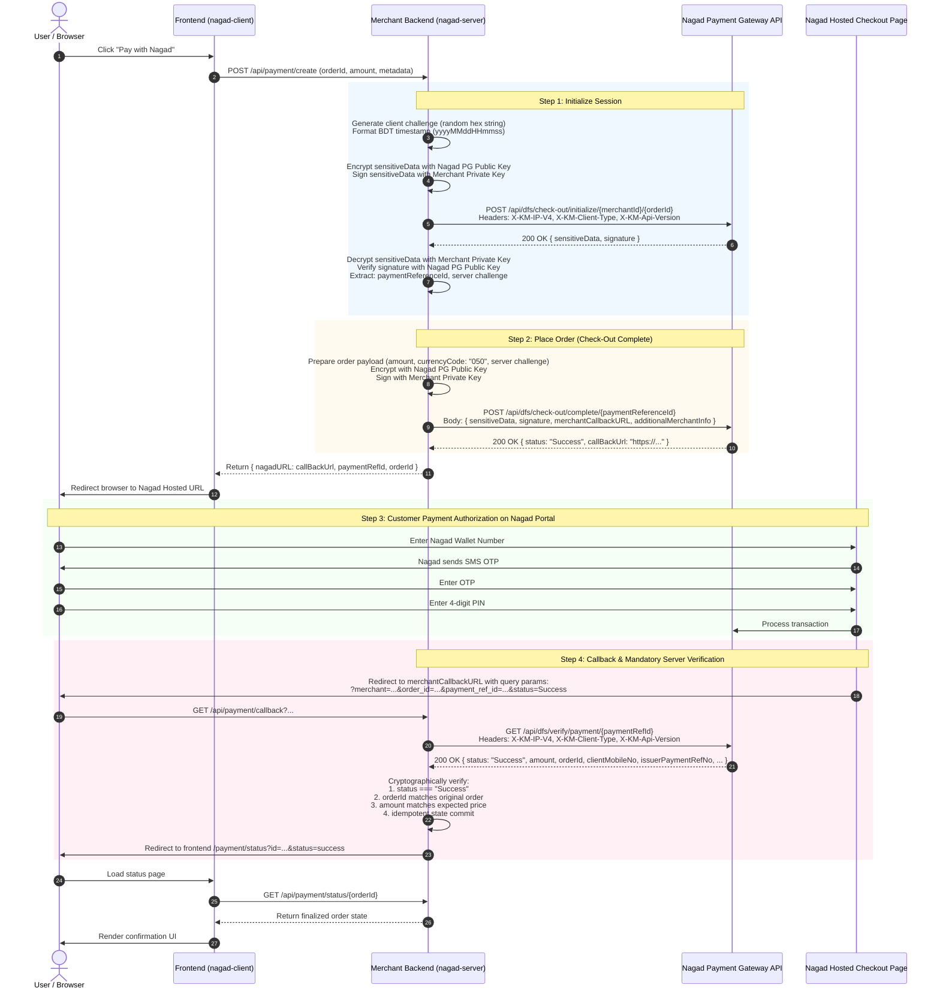

# Comprehensive Audit: Nagad Payment Gateway Integration

**Date**: 2026-10-25  
**Audit Scope**: Live code inspection (`LifeLineit/backend`, `LifeLineit/public`, `Payment-Gateway-Integration`), official documentation (`Nagad Online Payment API Integration Guide v3.3`), and community reference implementations.  
**Auditor**: Senior TypeScript Library Engineer (Pair Programming with ta-shanto)

---

## 1. Executive Summary

Nagad is a Bangladesh Postal Department-backed Mobile Financial Service (DFS/MFS) operated via Third Wave Technologies Limited (TWTL) with technology provided by Kona Software Lab Limited.

Unlike standard token-based payment gateways (e.g., Stripe, bKash Checkout), Nagad's handshake is a **cryptographic protocol** requiring asymmetric RSA cryptography:
1. Two-step checkout initiation (**Initialize** $\to$ **Complete**).
2. End-to-end payload encryption using RSA PKCS#1 v1.5 padding with the **Nagad Payment Gateway (PG) Public Key**.
3. Digital signatures using RSA-SHA256 (or SHA1withRSA in legacy docs) with the **Merchant Private Key**.
4. Client redirect to a Nagad-hosted checkout page (customer enters mobile, OTP, PIN).
5. Callback redirect back to the merchant server with query parameters.
6. Server-side payment verification call via Nagad's verification API.

The live codebase at `LifeLineit` works in production, but possesses severe vulnerabilities (pending payment race conditions, missing amount validation, weak order ID generation, lack of replay prevention). This audit provides the blueprint for building our enterprise-grade, MIT-licensed `nagad-server` and `nagad-client` packages.

---

## 2. Sequence Diagrams: The Complete Payment Flow

### 2.1 Complete End-to-End Payment Sequence



---

## 3. Cryptography Specification & Observed Details

| Cryptographic Attribute | Specification | Implementation in Live Code | Notes & Hardening Requirements |
| :--- | :--- | :--- | :--- |
| **Asymmetric Algorithm** | RSA 2048-bit | RSA 2048-bit (PEM format) | Support PKCS#1 and PKCS#8 formats, multiline or single-line base64 env vars. |
| **Encryption Algorithm** | RSA Public Key Encryption | `crypto.publicEncrypt()` with `RSA_PKCS1_PADDING` | Outgoing payloads encrypted with **Nagad PG Public Key**. |
| **Decryption Algorithm** | RSA Private Key Decryption | `crypto.privateDecrypt()` with `RSA_PKCS1_PADDING` | Incoming `sensitiveData` decrypted with **Merchant Private Key**. |
| **Padding** | PKCS#1 v1.5 | `crypto.constants.RSA_PKCS1_PADDING` | Strict adherence required by Nagad PG. OAEP is NOT supported by Nagad PG. |
| **Digital Signature Algorithm** | RSA Signature | `RSA-SHA256` (`crypto.createSign("RSA-SHA256")`) | **Discrepancy Note**: Older PDF spec (v1.3) mentioned `SHA1withRSA`. Live production code runs `RSA-SHA256`. Our `CryptoProvider` will default to `RSA-SHA256` with configurable fallback. |
| **Signature Verification** | RSA Verify | `crypto.createVerify("RSA-SHA256")` | Verify Nagad's signature on decrypted payloads using **Nagad PG Public Key**. |
| **Payload Encoding** | Base64 | Base64 string (`Buffer.from(..., 'base64')`) | All encrypted ciphertexts and signatures sent as Base64 strings. |
| **Timestamp Format** | `yyyyMMddHHmmss` (14 digits) | Formatted UTC+6 (Asia/Dhaka) | Sensitive to clock skew. Nagad rejects if outside allowed window (code `16_0006_076`). |
| **Challenge / Nonce** | Random Hex String | Generated via `crypto.randomBytes(16).toString('hex')` (32 chars) or 40 hex chars | Init generates client challenge; Nagad responds with server challenge; Complete request must echo back server challenge. |

### Key Matrix: Who Holds & Uses What?

```
+-----------------------------------------------------------------------------------+
| Entity           | Key                           | Purpose                        |
|------------------+-------------------------------+--------------------------------|
| Merchant Server  | Merchant Private Key          | Signs outgoing requests        |
|                  |                               | Decrypts incoming responses    |
|------------------+-------------------------------+--------------------------------|
| Merchant Server  | Nagad PG Public Key           | Encrypts outgoing requests     |
|                  |                               | Verifies Nagad signatures      |
|------------------+-------------------------------+--------------------------------|
| Client (Browser) | ZERO KEYS                     | NEVER exposes any keys         |
|                  |                               | Talks only to Merchant Backend |
+-----------------------------------------------------------------------------------+
```

---

## 4. Environment Base URLs

| Environment | Base URL (API context) | Live Code / Docs Reference |
| :--- | :--- | :--- |
| **Production** | `https://api.mynagad.com/api/dfs` | `LifeLineit/backend/utils/nagad.js` |
| **Sandbox (Modern SSL)** | `https://sandbox-ssl.mynagad.com/api/dfs` | `LifeLineit/backend/nagadready/index.ts` |
| **Sandbox (Port 10080)** | `https://sandbox.mynagad.com:10080/api/dfs` | `Payment-Gateway-Integration/backend/services/nagad.service.js` |
| **Legacy Docs Sandbox** | `http://sandbox.mynagad.com:10080/remote-payment-gateway-1.0/api/dfs` | `nagad.pdf` (Version 3.3, Oct 2021) |

> [!IMPORTANT]
> In `nagad-server`, base URLs must be configurable via `env` (`production` vs `sandbox`) and an explicit `baseUrl` override to allow seamless operation behind proxies, mock test servers, or custom gateways.

---

## 5. Mandatory HTTP Headers

Every request made to Nagad APIs requires the following headers:

```http
X-KM-IP-V4: <Merchant-Public-Egress-IP>
X-KM-Client-Type: PC_WEB
X-KM-Api-Version: v-0.2.0
Content-Type: application/json
Accept: application/json
```

- **`X-KM-IP-V4`**: Nagad verifies that this header matches the merchant's registered egress IP address whitelisted in the Nagad Merchant Portal.
- **`X-KM-Client-Type`**: Allowed values per official spec:
  - `PC_WEB` (Standard web checkout)
  - `MOBILE_WEB` (Mobile browser checkout)
  - `MOBILE_APP` (App integration)
  - `WALLET_WEB_VIEW` (Embedded in-app webview)
  - `BILL_KEY` (Tokenized recurring payments)
- **`X-KM-Api-Version`**:
  - `v-0.2.0`: Standard base version (supports checkout, verification).
  - `v-3.0.1`: Spec revision supporting `otherAmount.serviceFee` charging.

---

## 6. Callback & Redirect Handling in Frontend and Backend

### 6.1 Nagad Callback Format (Redirect to Merchant Server)
When the user finishes or cancels payment, Nagad redirects the browser via HTTP `GET` to the merchant's `merchantCallbackURL`:

```http
GET https://merchant.com/api/payment/nagad/callback?merchant=683002007104225&order_id=ORD123456&payment_ref_id=MTEwNzE2NTMx...&status=Success&status_code=00_000_000&payment_dt=20261025200503&issuer_payment_ref=70IZV6G7
```

**Query Parameters Passed by Nagad:**
- `merchant`: Merchant ID (15 chars)
- `order_id`: The merchant-supplied order ID (5-20 chars)
- `payment_ref_id`: Nagad's unique reference token for this transaction (10-60 chars)
- `status`: Transaction status string (`Success`, `Cancelled`, `Failed`, etc.)
- `status_code`: Internal code (e.g., `00_000_000` or `00_000_00`)
- `payment_dt`: Timestamp of payment (`yyyyMMddHHmmss`)
- `issuer_payment_ref`: Transaction authorization code / TrxID (8-20 chars)

### 6.2 Frontend Navigation Flow
1. Backend verifies the payment reference directly against Nagad API (`/api/dfs/verify/payment/{paymentRefId}`).
2. Backend securely records transaction success or failure in the persistent database.
3. Backend issues an HTTP 302 redirect sending the customer to the frontend results page:
   - Success: `${FRONTEND_URL}/payment/status?id=${orderId}&status=success`
   - Cancelled: `${FRONTEND_URL}/payment/status?id=${orderId}&status=cancelled`
   - Failure: `${FRONTEND_URL}/payment/status?id=${orderId}&status=failed&reason=...`
4. The client application reads query params, queries the merchant's authenticated status endpoint, and renders the payment confirmation screen without ever trusting client-provided URL state.

---

## 7. Audit of Live Code: Bugs, Vulnerabilities, and Gaps

An exhaustive line-by-line inspection of `LifeLineit` and `Payment-Gateway-Integration` revealed critical security vulnerabilities and reliability defects that our library must eliminate:

### 🚨 Critical Vulnerability 1: Race Condition & Cross-User Payment Hijacking
- **Location**: `LifeLineit/backend/controllers/payment.controller.js:737-750`
- **Flaw**:
  ```javascript
  if (!payment) {
    payment = await Payment.findOne({
      paymentMethod: "Nagad",
      status: "pending",
    }).sort({ createdAt: -1 });
    if (payment) {
      payment.manualDetails.transactionId = actualPaymentRefId;
      await payment.save();
    }
  }
  ```
- **Exploitation**: If two users checkout at similar times and one callback experiences an order ID lookup glitch, the system grabs the *most recent pending payment in the database* regardless of customer identity. User A's payment could credit User B's order!
- **Library Fix**: Enforce strict, non-negotiable matching against the unique `orderId` stored at initiation. Never fall back to arbitrary "latest" records.

### 🚨 Critical Vulnerability 2: Missing Amount & Currency Verification
- **Location**: `LifeLineit/backend/controllers/payment.controller.js:710-725`
- **Flaw**: The backend calls `verifyPayment()`, checks if `status === "Success"`, but **never compares `verifyData.amount` with `payment.amount`**!
- **Exploitation**: An attacker could initialize an order for 1.00 BDT, capture the callback parameters, and pass them to a callback handler waiting for an expensive 10,000 BDT order.
- **Library Fix**: `nagad-server`'s `verify()` method must accept the expected order details (e.g., `{ orderId, amount, currency }`) and fail with `NagadAmountMismatchError` if `verifyData.amount !== expectedAmount`.

### 🚨 Critical Vulnerability 3: Weak Order ID Collision
- **Location**: `LifeLineit/backend/controllers/payment.controller.js:560`
- **Flaw**: Order IDs generated with 5 random digits (`LIT` + 10000-99999).
- **Impact**: Birthday paradox creates collisions within days. Nagad explicitly returns Error `16_0006_083`: *"Duplicate Order ID in same day"*, immediately breaking checkout for paying customers.
- **Library Fix**: Provide a cryptographically robust, collision-resistant default order ID generator complying with Nagad's 5-20 alphanumeric character constraint (e.g., base62 timestamp + secure entropy).

### 🚨 Critical Vulnerability 4: Lack of Replay Protection & Idempotency
- **Location**: `LifeLineit/backend/controllers/payment.controller.js:780-840`
- **Flaw**: No distributed lock or atomic state transition. Callback handling immediately triggers emails, course enrollments, and affiliate commissions without checking if the payment was already `confirmed`.
- **Exploitation**: Replaying the callback URL duplicates side effects and commissions.
- **Library Fix**: Built-in state machine transitions (`initialized` $\to$ `redirected` $\to$ `callback_received` $\to$ `verified` $\to$ `success|failed|cancelled`) with an pluggable idempotency store (Memory, Redis, or custom DB adapter).

### 🚨 Critical Vulnerability 5: Hardcoded Client IP & Lack of Redaction
- **Location**: `LifeLineit/backend/utils/nagad.js:130`
- **Flaw**: Hardcoded fallback IP `72.60.200.110` in header `X-KM-IP-V4`. Keys and full payloads printed in plaintext via `console.log`.
- **Library Fix**: Automatic outbound IP detection with clear error messaging if missing; built-in structured logger with automated PII and secret redaction.

---

## 8. Operational Prerequisites for Nagad Merchants

To successfully use `nagad-server` in production, merchants must configure the following:

1. **Nagad Merchant Account**: Formal agreement with Nagad / Third Wave Technologies Limited.
2. **Merchant ID**: 15-character identifier allocated by Nagad.
3. **Public Egress IP Whitelisting**: The production server's public IPv4 address must be whitelisted in Nagad's firewall and passed in `X-KM-IP-V4`.
4. **RSA Key Pair Generation**:
   - Generate private key: `openssl genrsa -out merchant_private.pem 2048`
   - Extract public key: `openssl rsa -in merchant_private.pem -pubout -out merchant_public.pem`
5. **Upload Public Key to Nagad Portal**: Merchant public key uploaded via Nagad Merchant Portal.
6. **Obtain Nagad PG Public Key**: Download Nagad's public certificate from portal.
7. **Callback URL Whitelisting**: Public HTTPS domain registered in Nagad's merchant configuration.

---

## 9. Feature Support Matrix

| Feature | Status | Verification Source | Implementation Plan in Monorepo |
| :--- | :--- | :--- | :--- |
| **Checkout Session Initialize** | **Confirmed** | Live code & Official Spec v3.3 §5.2.8.1 | Core `nagad-server`: `nagad.checkout.create()` |
| **Place Order (Complete)** | **Confirmed** | Live code & Official Spec v3.3 §5.2.8.2 | Core `nagad-server`: auto-chained in checkout initiation |
| **Hosted Checkout Redirect** | **Confirmed** | Live code & Official Spec v3.3 §5.2.8.2.5 | Core `nagad-server` + `nagad-client` |
| **Callback Verification** | **Confirmed** | Live code & Official Spec v3.3 §5.2.8.3 | Core `nagad-server`: `nagad.checkout.verify()` with order & amount checks |
| **Payment Status Query (Check)**| **Confirmed** | Live code & Official Spec v3.3 §5.2.8.3 | Core `nagad-server`: `nagad.payment.getStatus(paymentRefId)` |
| **RSA-PKCS1 Encryption / Decryption** | **Confirmed** | Live code & Official Spec v3.3 §5.1.1 | Zero-dep `CryptoProvider` using native Node `crypto` / WebCrypto |
| **Digital Signing (RSA-SHA256)** | **Confirmed** | Live code `utils.js` | Built-in default in `CryptoProvider` |
| **Digital Signing (SHA1withRSA)**| **Confirmed** | Spec v3.3 §5.1.1 | Fallback flag in `CryptoProvider` |
| **Framework Adapters** | **Planned** | Clean architecture | Subpath exports for Express, Fastify, Hono, Next.js, NestJS |
| **Client State Machine** | **Planned** | Architecture requirements | Core `nagad-client` with React hooks, React Native WebView, Vue, Angular |
| **Refund API** | **UNVERIFIED** | Missing in live code & docs | Not confirmed in DFS v3.3 API spec. Listed under UNVERIFIED. |
| **Server-to-Server Webhook (IPN)** | **UNVERIFIED** | Live code only uses browser GET callback | Nagad spec only mentions GET callback redirect. Listed under UNVERIFIED. |

---

## 10. Nagad Error Code Taxonomy (Derived from Official Documentation)

The official integration guide documents standard error codes formatted as `XX_XXXX_XXX`. `nagad-server` will map these to strongly-typed TypeScript error classes:

| Code | Nagad Official Message | `nagad-server` Error Class |
| :--- | :--- | :--- |
| `16_0006_004` / `16_0006_050` | Provided merchant ID is invalid | `NagadInvalidMerchantError` |
| `16_0006_052` | Invalid Merchant | `NagadInvalidMerchantError` |
| `16_0006_053` | Inactive Merchant | `NagadInactiveMerchantError` |
| `16_0006_056` | Encryption failed | `NagadCryptoError` |
| `16_0006_057` | Decryption failed | `NagadCryptoError` |
| `16_0006_058` | Failed to verify signature | `NagadSignatureVerificationError` |
| `16_0006_059` | Invalid Sensitive Data | `NagadInvalidPayloadError` |
| `16_0006_060` | Error processing sensitive data | `NagadInvalidPayloadError` |
| `16_0006_061` | Invalid merchant key | `NagadKeyError` |
| `16_0006_064` | Mandatory Header Missing | `NagadMissingHeaderError` |
| `16_0006_068` | Invalid Order Id | `NagadInvalidOrderIdError` |
| `16_0006_076` | Transaction Date Time Not in allowed window | `NagadClockSkewError` |
| `16_0006_081` | Invalid Date Time Format | `NagadInvalidTimestampError` |
| `16_0006_083` | Duplicate Order ID in same day | `NagadDuplicateOrderIdError` |
| `16_0006_055` | Invalid Payment Reference Id | `NagadInvalidPaymentRefError` |
| `16_0006_080` | Invalid Currency Code | `NagadInvalidCurrencyError` |
| `16_0006_999` | Invalid Request | `NagadInvalidRequestError` |

---

## 11. UNVERIFIED Items & Clarification Questions

As mandated by Hard Rule #1, we never invent API facts. The following points are explicitly unconfirmed:

1. **Refund API**:
   - *Status*: UNVERIFIED. Neither the live integration nor the official PDF guide (v3.3) provides an automated refund API endpoint. In most Bangladesh DFS gateways, refunds are initiated either via a dedicated batch portal, a separate B2B disbursement/dispute API, or manually.
   - *Question for User*: Does your Nagad merchant contract include an automated programmatic Refund API endpoint (e.g. `/api/dfs/refund` or `/api/dfs/cancel`), or should Phase 1-3 scope strictly cover Checkout, Verification, and Status checking?
2. **Signature Algorithm Versioning**:
   - *Status*: Confirmed that live code runs `RSA-SHA256` and succeeds in production, while PDF v3.3 spec documents `SHA1withRSA`.
   - *Design Decision*: We will implement `RSA-SHA256` as the default in `CryptoProvider` while supporting an explicit config option `signatureAlgorithm: 'SHA256' | 'SHA1'` for legacy compatibility.
3. **Webhook / Server-to-Server Instant Payment Notification (IPN)**:
   - *Status*: UNVERIFIED. Live code and docs only detail the customer-driven browser redirect callback (`GET`).
   - *Question for User*: Does Nagad provide an asynchronous server-to-server POST webhook or IPN for out-of-band payment events, or is the user redirect + polling check the sole supported mechanism?
4. **Sandbox Endpoints**:
   - *Status*: Both `https://sandbox-ssl.mynagad.com/api/dfs` and `https://sandbox.mynagad.com:10080/api/dfs` appear in reference code.
   - *Design Decision*: We will default sandbox base URL to `https://sandbox.mynagad.com:10080/api/dfs` with full ability to override via options.

---

## 12. Conclusion & Phase 0 Gate Check

Phase 0 Audit is complete. Scope for Phase 1 will be built **strictly from the Confirmed feature set**:
- High-performance, zero-runtime-dependency core with `CryptoProvider` (Node `crypto` + WebCrypto for Edge).
- Flexible key loaders (PEM string, file path, base64 env vars, or custom provider).
- Layered control: zero-config env, typed options, lifecycle hooks, transport injection, atomic idempotency store.
- Bulletproof payment verification checking order ID, amount, currency, and merchant ID.
- Typed error taxonomy mapping Nagad's official error codes.
