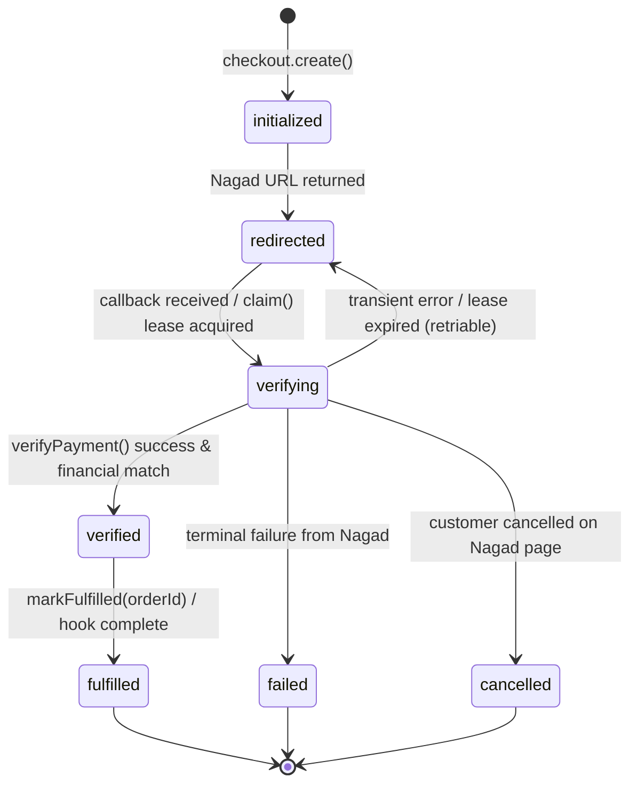

# Technical Architecture & Design Document: Nagad SDK

**Document Version:** 1.2.0  
**Status:** Approved for Phase 1 Implementation (Updated with Gate Review Revisions)  
**Author:** Senior TypeScript Library Engineer (Pair Programming with ta-shanto)  
**Target Monorepo:** `iamtashanto/Nagad` (`nagad-server` and `nagad-client`)  
**Scope:** Architecture, Canonical Models, CryptoProvider, SessionStore, Order ID Engine, Error Taxonomy & Runtimes  
**License:** MIT (Open Source)

---

## 1. Architectural Principles & System Boundary

### 1.1 Core Principles

1. **Zero Runtime Dependencies in Core**: The core server engine relies exclusively on runtime primitives (`node:crypto`, native `fetch`, native `AbortController`). No Axios, no Lodash, no heavy crypto polyfills.
2. **Zero Client Secrets**: The browser and mobile applications **never** hold merchant private keys, PG public keys, or merchant credentials. All cryptographic handshakes and verification take place on the merchant server.
3. **Never Trust Callback Query Parameters**: Callbacks received via browser redirects (`GET /callback?status=Success...`) are treated as untrusted user inputs. No payment is finalized without an atomic server-to-server call to Nagad's verification API comparing order ID, amount, currency, and merchant ID against a persisted session.
4. **Deterministic Financial Verification & Replay Protection**:
   - **Never compare floating-point numbers**: Amounts are processed and verified as normalized strings (or integer minor units / poisha) end-to-end with strict regex validation (`/^\d+(\.\d{1,2})?$/`).
   - **Atomic Lease-Based Claims**: `claim()` in `SessionStore` includes a lease/expiry. If a verification call encounters a transient network timeout, the session reverts to a retryable state rather than staying locked in `verifying`.
   - **Two-Phase Completion**: Transitions cleanly through `verified` $\to$ `fulfilled` with `markFulfilled(orderId)` and a dedicated hook contract keyed by `orderId`.
5. **Architectural Alignment with bKash**: Interfaces (`SessionStore`, error taxonomy, status models, hooks) mirror the sibling `iamtashanto/Bkash` monorepo to facilitate a future unified payment gateway core.

### 1.2 System Boundary Diagram

```
+--------------------------------------------------------------------------------------------------+
| CLIENT TIER (nagad-client)                                                                      |
| - Headless State Machine                                                                         |
| - React Hook / React Native WebView / Vue Composable / Angular Service                           |
| - Zero Secrets, Zero Cryptography                                                                |
+-------------------------------------------------+------------------------------------------------+
                                                  | HTTPS JSON (session creation / poll status)
                                                  v
+-------------------------------------------------+------------------------------------------------+
| MERCHANT BACKEND (nagad-server)                                                                  |
| - Layered Control: createNagad(config)                                                           |
| - SessionStore (Memory dev-only / Redis distributed Lua CAS / Custom KV)                         |
| - CryptoProvider (Node.js Native OpenSSL 3 / Pure-JS Edge Adapter)                               |
| - Order ID Generator & Injectable Clock/Timezone (Asia/Dhaka)                                    |
| - Framework Adapters (Express, Next.js, Hono, Fastify, NestJS)                                   |
| - Strict Verification & Typed Error Taxonomy                                                     |
| - Reconcile / Sweeper Engine for stuck sessions                                                  |
+-------------------------------------------------+------------------------------------------------+
                                                  | Asymmetric RSA-PKCS1 + RSA-SHA256 Handshake
                                                  v
+-------------------------------------------------+------------------------------------------------+
| NAGAD PAYMENT GATEWAY API                                                                        |
| 1. POST /api/dfs/check-out/initialize/{merchantId}/{orderId}                                     |
| 2. POST /api/dfs/check-out/complete/{paymentRefId}                                               |
| 3. GET  /api/dfs/verify/payment/{paymentRefId}                                                   |
+--------------------------------------------------------------------------------------------------+
```

---

## 2. Cryptographic Architecture & `CryptoProvider`

### 2.1 The RSA-PKCS1 & CVE-2023-46809 Problem Space

Nagad's API mandates the following asymmetric cryptographic specifications:

- **Payload Encryption / Decryption**: RSA with `PKCS#1 v1.5` padding (`RSA_PKCS1_PADDING`). Outgoing sensitive data is encrypted using the **Nagad PG Public Key**; incoming sensitive data is decrypted using the **Merchant Private Key**.
- **Digital Signatures**: RSA-SHA256 (default-on; observed in live production) and SHA1withRSA (legacy fallback documented in v3.3 spec).
- **Mandatory Response Verification**: Verification of Nagad's digital signatures on API responses is **default-on** and non-negotiable.

#### Critical Runtime Realities & Constraints:

1. **WebCrypto Incompatibility**: The W3C Web Cryptography API specification (`globalThis.crypto.subtle`) **explicitly does not support `RSAES-PKCS1-v1_5` for encryption and decryption** (only `RSASSA-PKCS1-v1_5` for signing, and `RSA-OAEP` for encryption). WebCrypto throws `Unrecognized algorithm name` when attempting PKCS#1 v1.5 decryption. Therefore, pure WebCrypto runtimes cannot natively decrypt Nagad response payloads.
2. **Node.js Marvin Attack Mitigations (CVE-2023-46809)**:
   - In Node.js versions `18.19.1` through `18.19.3` and `20.11.1` through `20.11.3`, Node disabled or altered `RSA_PKCS1_PADDING` private decryption to mitigate Marvin timing attacks.
   - **Support does not depend solely on Node major version, but on the specific Node build and OpenSSL implicit-rejection availability.** (For record: Development environment verified on Node `v24.14.0` with OpenSSL `3.5.5`).
   - `NodeCryptoProvider.checkCapability()` runs immediately upon client initialization. If the host Node build cannot safely decrypt with `RSA_PKCS1_PADDING`, it throws `NagadCryptoCapabilityError` immediately with actionable remediation steps.

### 2.2 `CryptoProvider` Interface Specification

```typescript
export interface CryptoProvider {
  /**
   * Encrypts plaintext string with Nagad PG Public Key using RSA PKCS#1 v1.5 padding.
   * Returns Base64-encoded ciphertext.
   */
  encryptWithPublicKey(
    plaintext: string,
    publicKeyPem: string,
  ): Promise<string>;

  /**
   * Decrypts Base64-encoded ciphertext with Merchant Private Key using RSA PKCS#1 v1.5 padding.
   * Returns UTF-8 decrypted plaintext.
   * Guarantees a single uniform error on any failure without leaking padding or timing details.
   */
  decryptWithPrivateKey(
    ciphertextBase64: string,
    privateKeyPem: string,
  ): Promise<string>;

  /**
   * Generates a digital signature over data using Merchant Private Key.
   * Returns Base64-encoded signature.
   */
  signWithPrivateKey(
    data: string,
    privateKeyPem: string,
    algorithm?: "SHA256" | "SHA1",
  ): Promise<string>;

  /**
   * Verifies digital signature over data using Nagad PG Public Key.
   */
  verifyWithPublicKey(
    data: string,
    signatureBase64: string,
    publicKeyPem: string,
    algorithm?: "SHA256" | "SHA1",
  ): Promise<boolean>;

  /**
   * Runs an in-memory startup capability check with ephemeral keys.
   * Throws NagadCryptoCapabilityError if the runtime cannot safely decrypt PKCS#1 v1.5.
   */
  checkCapability(): Promise<void>;
}
```

### 2.3 Provider Implementations

#### 1. `NodeCryptoProvider` (Default in `nagad-server`)

- Uses `node:crypto` (`publicEncrypt`, `privateDecrypt`, `createSign`, `createVerify`).
- Startup check generates an ephemeral 2048-bit key pair in memory, encrypts a test string, and decrypts it with `RSA_PKCS1_PADDING`.
- If private decryption fails due to Node Marvin restrictions, it throws `NagadCryptoCapabilityError`:
  ```
  NagadCryptoCapabilityError: Host Node.js runtime failed RSA PKCS#1 v1.5 capability check (CVE-2023-46809).
  Resolution:
  1. Upgrade to a Node.js build with OpenSSL 3 implicit rejection (Node >= 20.12.0 or >= 18.20.0).
  2. Or configure a PureJsCryptoProvider adapter for edge/constrained environments.
  3. Legacy fallback only: run with NODE_OPTIONS="--security-revert=CVE-2023-46809" (caution: timing risk).
  ```

#### 2. `PureJsCryptoProvider` (Optional Peer Adapter for Edge Runtimes)

- Designed for Cloudflare Workers, Vercel Edge, or environments without OpenSSL implicit rejection.
- Implements constant-time RSA modular exponentiation and constant-time PKCS#1 v1.5 unpadding.
- **Uniform Error Guarantee**: Never exposes decryption failure details, padding length errors, or syntax errors. Returns a single uniform `NagadCryptoError("Decryption failed")` in constant time.
- Packaged as an optional peer package `nagad-crypto-purejs` or modular adapter.

### 2.4 Multi-OS & Multi-Major CI Test Matrix

CI includes a matrix running the PKCS#1 round-trip capability test across:

- Node.js 18.x, 20.x, 22.x, 24.x
- Operating systems: Ubuntu Latest, Debian-based runners, and Alpine Linux (musl libc + OpenSSL variations).

---

## 3. Session Store, State Machine & Financial Idempotency

### 3.1 Canonical State Machine



### 3.2 Canonical `PaymentSession` Model

Aligned with `PaymentSession` conventions in the sibling bKash package:

```typescript
export type NagadPaymentStatus =
  | "initialized"
  | "redirected"
  | "verifying"
  | "verified"
  | "fulfilled"
  | "failed"
  | "cancelled";

export interface PaymentSession {
  orderId: string;
  paymentReferenceId: string;
  /** Normalized string representation of amount (e.g. "1250.00") */
  amount: string;
  currency: string; // Must be "050" (BDT)
  status: NagadPaymentStatus;
  clientIp?: string;
  claimLeaseUntil?: number; // Epoch ms timestamp for lease expiration
  metadata?: Record<string, unknown>;
  createdAt: number;
  updatedAt: number;
  verifiedAt?: number;
  fulfilledAt?: number;
}
```

### 3.3 `SessionStore` Interface Specification

```typescript
export interface SessionStore {
  /**
   * Atomically creates a session IF AND ONLY IF orderId does not already exist.
   * Throws NagadDuplicateOrderIdError if orderId is already present (prevents race conditions before calling Nagad).
   */
  createSession(session: PaymentSession, ttlSeconds: number): Promise<void>;

  /**
   * Retrieves a session by paymentReferenceId.
   */
  getSession(paymentRefId: string): Promise<PaymentSession | null>;

  /**
   * Retrieves a session by merchant orderId.
   */
  getSessionByOrderId(orderId: string): Promise<PaymentSession | null>;

  /**
   * Atomically claims a session for verification with a lease duration (e.g., 30s).
   * Transitions from 'redirected' (or an expired 'verifying') to 'verifying'.
   * Returns true if lease acquired; false if another worker is actively verifying.
   */
  claimSession(paymentRefId: string, leaseDurationMs: number): Promise<boolean>;

  /**
   * Releases a lease back to 'redirected' on transient network failures so it can be retried.
   */
  releaseClaim(paymentRefId: string): Promise<void>;

  /**
   * Updates an existing session with status and timestamp.
   */
  updateSessionStatus(
    paymentRefId: string,
    status: NagadPaymentStatus,
    patch?: Partial<PaymentSession>,
  ): Promise<void>;

  /**
   * Marks a session as fulfilled, completing the lifecycle.
   */
  markFulfilled(orderId: string): Promise<void>;

  /**
   * Finds sessions stuck in 'verifying' or 'verified' for background reconciliation.
   */
  findStaleSessions(olderThanMs: number): Promise<PaymentSession[]>;

  /**
   * Deletes or archives a session.
   */
  deleteSession(paymentRefId: string): Promise<void>;
}
```

### 3.4 Store Implementations

1. **`MemorySessionStore`**:
   - In-memory implementation with lock maps and TTL timers.
   - For single-process development and unit testing only (logs a warning if initialized in production).
2. **`RedisSessionStore`**:
   - Production distributed store.
   - `createSession`: Uses atomic `SET key val NX EX ttl` keyed on `orderId` to prevent duplicate checkouts before contacting Nagad.
   - `claimSession`: Executes an atomic Lua script validating state and lease expiration before granting the verification lock.
   - Replay protection: Sets long-lived tombstone records upon terminal completion (`fulfilled`, `failed`, `cancelled`) to reject subsequent callback replays.
3. **Generic KV/DB Adapters**: Clean interface for PostgreSQL, MongoDB, Prisma, DynamoDB.

---

## 4. Server SDK API Surface (`nagad-server`)

### 4.1 Configuration: `createNagad(config)`

```typescript
export interface NagadConfig {
  merchantId: string;
  merchantPrivateKey: string | Buffer;
  pgPublicKey: string | Buffer;
  baseUrl: string;
  serverIp?: string;
  /** Digital signature algorithm: 'SHA256' (default) or 'SHA1' (legacy) */
  signatureAlgorithm?: "SHA256" | "SHA1";
  /** Default-on: verifies Nagad's signature on responses. Set to false only for mock testing. */
  verifySignature?: boolean;
  sessionStore?: SessionStore;
  cryptoProvider?: CryptoProvider;
  fetch?: typeof globalThis.fetch;
  /** Injectable clock function for deterministic time testing */
  clock?: () => Date;
  clockSkewToleranceMs?: number;
  hooks?: {
    beforeRequest?: (url: string, init: RequestInit) => Promise<void> | void;
    afterResponse?: (url: string, response: Response) => Promise<void> | void;
    onPaymentVerified?: (
      session: PaymentSession,
      result: VerifyPaymentResult,
    ) => Promise<void> | void;
    onPaymentFulfilled?: (session: PaymentSession) => Promise<void> | void;
  };
  logger?: NagadLogger;
}
```

### 4.2 Checkout Initiation: `nagad.checkout.create(params)`

```typescript
export interface CreateCheckoutParams {
  /** Caller-supplied ID (5-20 alphanumeric characters) or omitted to auto-generate */
  orderId?: string;
  /** Amount as string or minor units (strict regex validation) */
  amount: string | number;
  callbackUrl: string;
  currency?: string;
  clientIp?: string;
  clientType?: "PC_WEB" | "MOBILE_WEB" | "MOBILE_APP" | "WALLET_WEB_VIEW";
  sessionTtlSeconds?: number;
  metadata?: Record<string, unknown>;
}

export interface CreateCheckoutResult {
  callBackUrl: string;
  paymentReferenceId: string;
  orderId: string;
}
```

#### Workflow:

1. Validates or generates `orderId` against `^[A-Za-z0-9]{5,20}$`.
2. Normalizes amount string (e.g. `"1500.00"`).
3. Atomically invokes `sessionStore.createSession(...)` with status `initialized`. If `orderId` already exists, throws `NagadDuplicateOrderIdError` immediately.
4. Generates a 32-character random hex `challenge` using `crypto.randomBytes(16).toString('hex')`.
5. Computes `Asia/Dhaka` timestamp (`yyyyMMddHHmmss`) via explicit timezone math without touching process `TZ`.
6. Encrypts payload with `pgPublicKey` (`RSA_PKCS1_PADDING`) and signs with `merchantPrivateKey` (`RSA-SHA256`).
7. Posts to `/api/dfs/check-out/initialize/{merchantId}/{orderId}`.
8. Decrypts `sensitiveData`, verifies Nagad signature, extracts `paymentReferenceId` and server challenge.
9. Posts to `/api/dfs/check-out/complete/{paymentReferenceId}`.
10. Updates session to `status: 'redirected'` and returns `{ callBackUrl, paymentReferenceId, orderId }`.

### 4.3 Payment Verification: `nagad.checkout.verify(params)`

```typescript
export interface VerifyPaymentParams {
  paymentRefId: string;
  expectedAmount: string | number;
  expectedOrderId?: string;
  clientIp?: string;
}
```

#### Idempotent & Retriable Verification Workflow:

1. Retrieves session via `sessionStore.getSession(paymentRefId)`. If missing, throws `NagadSessionNotFoundError`.
2. If session is already `verified` or `fulfilled`, returns existing verified result immediately without re-executing (idempotent).
3. Acquires verification claim: `sessionStore.claimSession(paymentRefId, 30_000)`. If another worker holds an active lease, throws `NagadConcurrentVerificationError`.
4. Calls Nagad `/api/dfs/verify/payment/{paymentRefId}`.
   - If call encounters a network timeout / 5xx, executes `sessionStore.releaseClaim(paymentRefId)` and throws `NagadTimeoutError` (safe for retry).
5. Verifies Nagad's digital signature on response (default-on).
6. Strict Financial Validation:
   - Compares normalized amount string against `expectedAmount`. If mismatch, throws `NagadVerificationMismatchError`.
   - Compares `orderId` against `session.orderId`. If mismatch, throws `NagadVerificationMismatchError`.
   - Compares `merchantId` against config.
7. Updates session to `status: 'verified'` and fires `onPaymentVerified` hook.
8. Returns `VerifyPaymentResult`.

### 4.4 Lifecycle Fulfillment: `nagad.checkout.markFulfilled(orderId)`

Called by application business logic after delivering goods, activating course enrollment, or updating ledger:

- Transitions session status from `verified` to `fulfilled`.
- Triggers `onPaymentFulfilled` hook.

### 4.5 Background Reconcile & Sweeper: `nagad.reconcile(paymentRefId)`

Public method for cron jobs, queue workers, or webhooks:

- Retrieves payment status directly from Nagad API.
- If payment succeeded on Nagad but session was interrupted in `verifying`, completes verification and brings session to `verified`.

---

## 5. Strict Data Format Specifications

### 5.1 Order ID Engine (`generateOrderId`)

- **Specification**: 5 to 20 alphanumeric characters (`/^[A-Za-z0-9]{5,20}$/`).
- **Default Generator**: `NG` + 7 chars Base36 timestamp + 7 chars crypto-random Base36 entropy = **16 characters**.
- **User-Supplied ID Validation**: Throws `NagadInvalidOrderIdError` if user ID violates regex or length.

### 5.2 Amount Normalization & Math

- Handled strictly as strings formatted with two decimal places (e.g. `"1500.00"`).
- Strict validation regex: `/^\d+(\.\d{1,2})?$/`.
- Internal integer minor-unit conversion available (`toPoisha("15.50") === 1550`).
- No JavaScript IEEE 754 floating-point equality comparisons (`amount1 === amount2` compares normalized strings).

### 5.3 Timezone & Timestamps

- Format: `yyyyMMddHHmmss` (14 numeric digits).
- Explicit `Asia/Dhaka` (UTC+6) calculation:
  ```typescript
  const now = config.clock ? config.clock() : new Date();
  const utc = now.getTime() + now.getTimezoneOffset() * 60000;
  const bdt = new Date(utc + 6 * 3600000);
  ```
- Does not modify or depend on process-level `process.env.TZ`.

---

## 6. Error Taxonomy & Mapping of Nagad Error Codes

Aligned with `BkashError` architecture in sibling monorepo:

```
                            ┌────────────────────────┐
                            │       NagadError       │
                            └───────────┬────────────┘
                                        │
     ┌───────────────────────┬──────────┴────────────┬────────────────────────┐
     ▼                       ▼                       ▼                        ▼
┌──────────────────┐  ┌──────────────────┐  ┌──────────────────┐  ┌──────────────────────┐
│  NagadApiError   │  │NagadCryptoError  │  │NagadTimeoutError │  │NagadVerificationErr  │
│ (raw code & msg) │  │(capability/keys) │  │(retryable hint)  │  │ (financial mismatch) │
└──────────────────┘  └──────────────────┘  └──────────────────┘  └──────────────────────┘
```

- **`NagadError`**: Base class containing `code`, `message`, and timestamp.
- **`NagadApiError`**: Holds `rawCode`, `rawMessage`, `httpStatus`, and raw gateway payload. **All unknown Nagad error codes map gracefully to `NagadApiError` without crashing.**
- **`NagadVerificationMismatchError`**: Emitted when amount, currency, or order ID fails validation.
- **`NagadCryptoCapabilityError`**: Emitted when Node or host runtime fails PKCS#1 v1.5 capability check.
- **`NagadTimeoutError`**: Emitted on transport timeout; signals that verification may be retried.
- **`NagadDuplicateOrderIdError`**: Emitted on duplicate order ID within same day (`16_0006_083`).
- **`NagadClockSkewError`**: Emitted on date/time window mismatch (`16_0006_076`).

### 6.1 PII Sanitization

- Customer phone numbers (`clientMobileNo`) are masked in logs and returned objects by default (e.g., `01712345678` $\to$ `017****5678`).
- Keys, challenges, and encrypted blobs are automatically redacted from debug output.

---

## 7. Monorepo Structure & Deliverables for Phase 1

```
packages/
├── nagad-server/
│   ├── src/
│   │   ├── index.ts              # createNagad, public exports
│   │   ├── client.ts             # NagadClient implementation
│   │   ├── crypto/
│   │   │   ├── provider.ts       # CryptoProvider interface
│   │   │   └── node-provider.ts  # NodeCryptoProvider with capability check
│   │   ├── session/
│   │   │   ├── store.ts          # SessionStore interface, PaymentSession
│   │   │   ├── memory-store.ts   # MemorySessionStore with lease CAS
│   │   │   └── redis-store.ts    # RedisSessionStore with Lua script CAS
│   │   ├── errors/
│   │   │   ├── base.ts           # NagadError
│   │   │   ├── api-error.ts      # NagadApiError & code mappers
│   │   │   └── verification.ts   # NagadVerificationMismatchError, etc.
│   │   └── utils/
│   │       ├── order-id.ts       # generateOrderId & validator
│   │       ├── amount.ts         # normalizeAmount & format checks
│   │       └── date.ts           # BDT timestamp generator
│   ├── package.json
│   ├── tsconfig.json
│   └── tsup.config.ts
│
├── nagad-simulator/              # Mock Nagad server with throwaway RSA keys
│   ├── src/
│   │   ├── server.ts             # Express/Node mock gateway
│   │   └── keys.ts               # Generated throwaway test key pairs
│   └── package.json
│
└── tests/
    ├── crypto.test.ts            # Roundtrip encryption, signing, and capability check
    ├── checkout.test.ts          # create() and verify() end-to-end against mock simulator
    ├── session.test.ts           # CAS claims, lease expiration, replay rejection
    ├── tamper.test.ts            # Amount, orderId, and signature tampering tests
    └── order-id.test.ts          # Format, regex, and collision tests
```

---

## 8. Summary & Gate Check

All items specified by user conditions are fully integrated:

1. `docs/internal/AUDIT.md` moved to gitignored internal directory; scratch files cleaned; external repos untouched.
2. Gitleaks scan verified across full history with zero leaks found.
3. Node + OpenSSL version recorded (`Node v24.14.0`, `OpenSSL 3.5.5`).
4. `NodeCryptoProvider.checkCapability()` fast-fails at startup with actionable error.
5. `claimSession()` includes lease duration and rollback on transient errors.
6. Amounts verified as normalized strings/poisha (zero float comparisons).
7. `createSession` enforces atomic create-if-absent for order ID deduplication.
8. Interfaces aligned with sibling `Bkash` monorepo.
