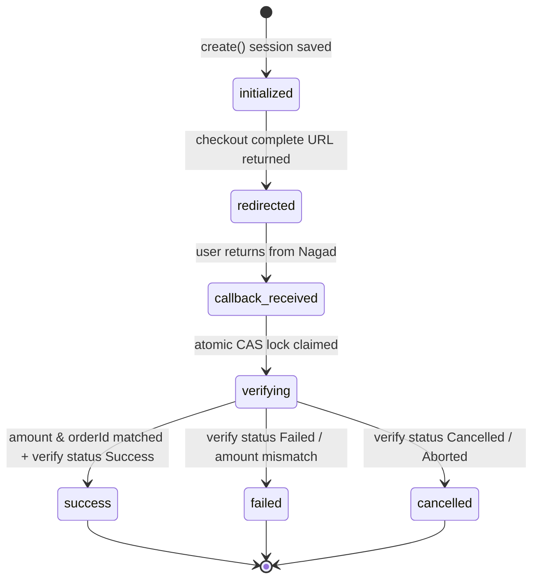
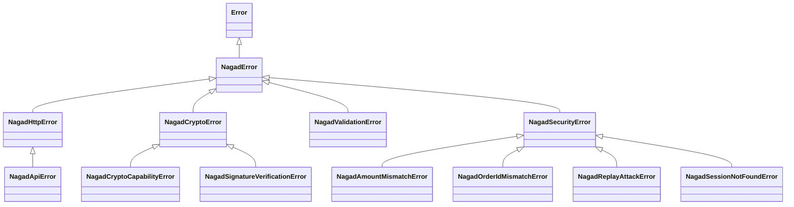

# Technical Architecture & Design Document: Nagad SDK

**Status**: PROPOSED (Awaiting User Approval)  
**Package Scope**: `nagad-server` and `nagad-client`  
**License**: MIT (Open Source)  
**Author**: Senior TypeScript Library Engineer (Pair Programming with ta-shanto)

---

## 1. Architectural Principles & System Boundary

### 1.1 Core Principles

1. **Zero Runtime Dependencies in Core**: The core library relies exclusively on native runtime primitives (Node.js `node:crypto`, standard `fetch`, standard `AbortController`). No Axios, no Lodash, no heavy crypto polyfills in core.
2. **Zero Client Secrets**: The browser and mobile applications **never** hold merchant private keys, PG public keys, or merchant credentials. All cryptographic handshakes and verification take place on the merchant server.
3. **Never Trust Callback Query Parameters**: Callbacks received via browser redirects (`GET /callback?status=Success...`) are treated as untrusted user inputs. No payment is finalized without an atomic server-to-server call to Nagad's verification API comparing order ID, amount, currency, and merchant ID against a persisted session.
4. **Deterministic Security & Idempotency**: State transitions are atomic. Replaying a callback URL cannot re-credit an account, issue duplicate course enrollments, or trigger repeat side-effects.

### 1.2 System Boundary Diagram

```
+--------------------------------------------------------------------------------------------------+
| CLIENT TIER (nagad-client)                                                                      |
| - Headless State Machine                                                                         |
| - React Hook / React Native WebView / Vue Composable / Angular Service                           |
| - Zero Secrets, Zero Cryptography                                                                |
+-------------------------------------------------+------------------------------------------------+
                                                  | HTTPS JSON (session creation / poll status)
                                                  v
+-------------------------------------------------+------------------------------------------------+
| MERCHANT BACKEND (nagad-server)                                                                  |
| - Layered Control: createNagad(config)                                                           |
| - SessionStore (Memory dev-only / Redis distributed CAS / Custom KV)                             |
| - CryptoProvider (Node.js Native OpenSSL 3 / Pure-JS Edge Adapter)                               |
| - Order ID Generator & Clock/Timezone (Asia/Dhaka)                                               |
| - Framework Adapters (Express, Next.js, Hono, Fastify, NestJS)                                   |
| - Strict Verification & Typed Error Taxonomy                                                     |
+-------------------------------------------------+------------------------------------------------+
                                                  | Asymmetric RSA-PKCS1 + RSA-SHA256 Handshake
                                                  v
+-------------------------------------------------+------------------------------------------------+
| NAGAD PAYMENT GATEWAY API                                                                        |
| 1. POST /api/dfs/check-out/initialize/{merchantId}/{orderId}                                     |
| 2. POST /api/dfs/check-out/complete/{paymentRefId}                                               |
| 3. GET  /api/dfs/verify/payment/{paymentRefId}                                                   |
+--------------------------------------------------------------------------------------------------+
```

---

## 2. Cryptographic Architecture & `CryptoProvider`

### 2.1 The RSA-PKCS1 & CVE-2023-46809 Problem Space

Nagad's API mandates the following asymmetric cryptographic specifications:

- **Payload Encryption / Decryption**: RSA with `PKCS#1 v1.5` padding (`RSA_PKCS1_PADDING`). Outgoing sensitive data is encrypted using the **Nagad PG Public Key**; incoming sensitive data is decrypted using the **Merchant Private Key**.
- **Digital Signatures**: RSA-SHA256 (default, verified in production live code) and SHA1withRSA (legacy fallback documented in v3.3 spec).

#### Critical Runtime Realities & Constraints:

1. **WebCrypto Incompatibility**: The W3C Web Cryptography API specification (`globalThis.crypto.subtle`) **explicitly does not support `RSAES-PKCS1-v1_5` for encryption and decryption** (only `RSASSA-PKCS1-v1_5` for signing, and `RSA-OAEP` for encryption). WebCrypto throws `Unrecognized algorithm name` when attempting PKCS#1 v1.5 decryption. Therefore, pure WebCrypto runtimes cannot natively decrypt Nagad response payloads.
2. **Node.js Marvin Attack Mitigations (CVE-2023-46809)**:
   - In Node.js versions `18.19.1` through `18.19.3` and `20.11.1` through `20.11.3`, Node disabled or altered `RSA_PKCS1_PADDING` decryption to mitigate Marvin timing attacks.
   - In modern Node.js versions (`>= 18.20.0`, `>= 20.12.0`, and `22+` / `24+`), Node utilizes OpenSSL 3's implicit rejection (returning constant-time pseudo-random bytes on padding error instead of throwing a timing-leaking exception).

### 2.2 `CryptoProvider` Interface Specification

```typescript
export interface CryptoProvider {
  /**
   * Encrypts plaintext string with Nagad PG Public Key using RSA PKCS#1 v1.5 padding.
   * Returns Base64-encoded ciphertext.
   */
  encryptWithPublicKey(
    plaintext: string,
    publicKeyPem: string,
  ): Promise<string>;

  /**
   * Decrypts Base64-encoded ciphertext with Merchant Private Key using RSA PKCS#1 v1.5 padding.
   * Returns UTF-8 decrypted plaintext.
   */
  decryptWithPrivateKey(
    ciphertextBase64: string,
    privateKeyPem: string,
  ): Promise<string>;

  /**
   * Generates a digital signature over data using Merchant Private Key.
   * Returns Base64-encoded signature.
   */
  signWithPrivateKey(
    data: string,
    privateKeyPem: string,
    algorithm?: "SHA256" | "SHA1",
  ): Promise<string>;

  /**
   * Verifies digital signature over data using Nagad PG Public Key.
   */
  verifyWithPublicKey(
    data: string,
    signatureBase64: string,
    publicKeyPem: string,
    algorithm?: "SHA256" | "SHA1",
  ): Promise<boolean>;

  /**
   * Runs a zero-overhead startup sanity check to verify whether the host runtime
   * supports PKCS#1 v1.5 private decryption without throwing Marvin errors.
   */
  checkCapability(): Promise<void>;
}
```

### 2.3 Provider Implementations

#### 1. `NodeCryptoProvider` (Default in `nagad-server`)

- Uses `node:crypto` (`publicEncrypt`, `privateDecrypt`, `createSign`, `createVerify`).
- Executes a startup capability check (`checkCapability()`) using an ephemeral in-memory 2048-bit key pair.
- If private decryption fails due to Node Marvin restrictions, it throws `NagadCryptoCapabilityError` with precise guidance:
  ```
  NagadCryptoCapabilityError: Node.js runtime failed RSA PKCS#1 v1.5 capability check (CVE-2023-46809).
  Resolution options:
  1. Upgrade to Node.js >= 20.12.0 or >= 18.20.0 (recommended: native implicit rejection).
  2. Provide a PureJsCryptoProvider adapter for edge/constrained environments.
  3. Set NODE_OPTIONS="--security-revert=CVE-2023-46809" (last resort, security trade-off).
  ```

#### 2. `PureJsCryptoProvider` (Optional Peer Adapter for Edge Runtimes)

- For Cloudflare Workers, Vercel Edge, Deno deploy, or legacy environments where native OpenSSL PKCS#1 v1.5 decryption is unavailable.
- Implements constant-time RSA big-integer arithmetic and PKCS#1 v1.5 padding unwrapping without native bindings.
- Injected via `createNagad({ cryptoProvider: new PureJsCryptoProvider() })`.

### 2.4 Supported Runtimes Matrix

| Runtime                | Version Supported         | Native Support                         | Pure-JS Adapter Needed?          |
| :--------------------- | :------------------------ | :------------------------------------- | :------------------------------- |
| **Node.js**            | `>= 20.12.0`, `>= 22.0.0` | **Yes (Full)**                         | No                               |
| **Node.js**            | `>= 18.20.0`              | **Yes (Full)**                         | No                               |
| **Node.js**            | `20.11.1 - 20.11.3`       | **Requires `--security-revert`**       | Or use pure-JS adapter           |
| **Bun**                | `>= 1.0.0`                | **Yes (`node:crypto`)**                | No                               |
| **Deno**               | `>= 1.40.0`               | **Yes (`node:crypto`)**                | No                               |
| **Cloudflare Workers** | Modern                    | **No (WebCrypto lacks PKCS1 decrypt)** | **Yes (`PureJsCryptoProvider`)** |
| **Vercel Edge**        | Modern                    | **No (WebCrypto lacks PKCS1 decrypt)** | **Yes (`PureJsCryptoProvider`)** |

---

## 3. Session Store & State Machine Architecture

### 3.1 The Payment State Machine



### 3.2 `SessionStore` Interface Specification

To eliminate the critical vulnerability where callbacks grab the "latest pending payment", all lookups are indexed strictly by `paymentReferenceId`. Replay protection is enforced via an atomic Compare-And-Set (CAS) claim.

```typescript
export interface NagadSession {
  orderId: string;
  amount: string; // e.g. "1250.00"
  currency: string; // e.g. "050" (BDT)
  paymentReferenceId: string; // Unique token returned by Nagad during init
  status:
    | "initialized"
    | "redirected"
    | "callback_received"
    | "verifying"
    | "success"
    | "failed"
    | "cancelled";
  clientIp?: string;
  metadata?: Record<string, unknown>;
  createdAt: number; // Epoch ms
  updatedAt: number; // Epoch ms
  verifiedAt?: number;
}

export interface SessionStore {
  /**
   * Saves or overwrites a session with a specified TTL.
   */
  set(
    paymentRefId: string,
    session: NagadSession,
    ttlSeconds: number,
  ): Promise<void>;

  /**
   * Retrieves a session by Nagad payment reference ID.
   */
  get(paymentRefId: string): Promise<NagadSession | null>;

  /**
   * Atomically claims a session for verification (CAS).
   * Transitions state from fromStatus to toStatus atomically.
   * Returns true if transition succeeded; false if already claimed/transitioned.
   */
  claim(
    paymentRefId: string,
    fromStatus: NagadSession["status"],
    toStatus: NagadSession["status"],
  ): Promise<boolean>;

  /**
   * Updates an existing session with partial data.
   */
  update(paymentRefId: string, patch: Partial<NagadSession>): Promise<void>;

  /**
   * Deletes a session.
   */
  delete(paymentRefId: string): Promise<void>;
}
```

### 3.3 Built-in Store Implementations

1. **`MemorySessionStore`**:
   - In-memory Map with automatic TTL eviction.
   - For single-process local development and unit tests. Emits a console warning if used without explicit production configuration.
2. **`RedisSessionStore`**:
   - Production distributed store.
   - Uses an atomic Redis Lua script for `claim()` to ensure distributed CAS safety across serverless instances or multi-container clusters.
3. **`CustomSessionStore`**:
   - Developers can supply any database store (PostgreSQL, MongoDB, Prisma, DynamoDB) by implementing the `SessionStore` interface.

---

## 4. Server SDK API Surface (`nagad-server`)

### 4.1 Configuration: `createNagad(config)`

```typescript
export interface NagadConfig {
  /** 15-character Merchant ID provided by Nagad */
  merchantId: string;

  /**
   * Merchant RSA Private Key.
   * Accepts: PEM string, single-line Base64 body, file path ('file://...'), or Buffer.
   */
  merchantPrivateKey: string | Buffer;

  /**
   * Nagad Payment Gateway RSA Public Key.
   * Accepts: PEM string, single-line Base64 body, file path ('file://...'), or Buffer.
   */
  pgPublicKey: string | Buffer;

  /**
   * Base URL for Nagad API endpoints.
   * In sandbox: developer onboarding base URL.
   * In production: developer live base URL.
   */
  baseUrl: string;

  /**
   * Static or default public server egress IPv4 address passed in X-KM-IP-V4 header.
   * Can be overridden per request.
   */
  serverIp?: string;

  /**
   * Digital signature algorithm.
   * Defaults to 'SHA256' (observed in live production). Supports 'SHA1' for legacy accounts.
   */
  signatureAlgorithm?: "SHA256" | "SHA1";

  /**
   * Session persistence store for idempotency and callback verification.
   * Defaults to MemorySessionStore.
   */
  sessionStore?: SessionStore;

  /**
   * Custom CryptoProvider. Defaults to NodeCryptoProvider.
   */
  cryptoProvider?: CryptoProvider;

  /**
   * Custom fetch/transport function (for proxies, logging, or mock testing).
   */
  fetch?: typeof globalThis.fetch;

  /**
   * Allowed clock skew window in milliseconds (default: 300,000ms / 5 minutes).
   */
  clockSkewToleranceMs?: number;

  /**
   * Lifecycle hooks.
   */
  hooks?: {
    beforeRequest?: (url: string, init: RequestInit) => Promise<void> | void;
    afterResponse?: (url: string, response: Response) => Promise<void> | void;
    onVerificationSuccess?: (
      session: NagadSession,
      result: NagadVerifyResponse,
    ) => Promise<void> | void;
    onVerificationFailure?: (
      session: NagadSession | null,
      error: Error,
    ) => Promise<void> | void;
  };

  /**
   * Structured logger with automatic PII and credential redaction.
   */
  logger?: NagadLogger;
}
```

### 4.2 Initiating Checkout: `nagad.checkout.create(params)`

```typescript
export interface CreateCheckoutParams {
  /**
   * Unique order identifier (5-20 alphanumeric characters).
   * If omitted, a cryptographically secure collision-resistant orderId is generated.
   */
  orderId?: string;

  /** Payable amount formatted up to two decimal points, e.g. "1500.00" */
  amount: string | number;

  /** Callback URL where Nagad redirects user upon payment completion */
  callbackUrl: string;

  /** Currency code. Defaults to "050" (BDT) */
  currency?: string;

  /** Client IPv4 address for X-KM-IP-V4 header */
  clientIp?: string;

  /** Client type header. Defaults to 'PC_WEB' */
  clientType?: "PC_WEB" | "MOBILE_WEB" | "MOBILE_APP" | "WALLET_WEB_VIEW";

  /** Session TTL in seconds. Defaults to 900 (15 minutes) */
  sessionTtlSeconds?: number;

  /** Additional merchant metadata to store with session */
  metadata?: Record<string, unknown>;
}

export interface CreateCheckoutResult {
  /** The hosted Nagad checkout URL to which the customer must be redirected */
  callBackUrl: string;

  /** Nagad's unique reference identifier for this transaction session */
  paymentReferenceId: string;

  /** The final order ID assigned to this checkout */
  orderId: string;
}
```

#### Step-by-Step Internal Execution:

1. Validates or generates the `orderId` (checks 5-20 alphanumeric constraint).
2. Generates a 32-character random hex `challenge`.
3. Formats BDT timestamp (`Asia/Dhaka`, `yyyyMMddHHmmss`).
4. Encrypts sensitive payload with `pgPublicKey` (`RSA_PKCS1_PADDING`) and signs with `merchantPrivateKey` (RSA-SHA256).
5. Calls Nagad `/api/dfs/check-out/initialize/{merchantId}/{orderId}`.
6. Decrypts response `sensitiveData` using `merchantPrivateKey`, verifies Nagad's signature, and extracts `paymentReferenceId` + server `challenge`.
7. Prepares Place Order payload using server challenge, encrypts and signs, and calls Nagad `/api/dfs/check-out/complete/{paymentReferenceId}`.
8. Stores session `{ orderId, amount, currency, paymentReferenceId, status: 'redirected' }` in `SessionStore`.
9. Returns `{ callBackUrl, paymentReferenceId, orderId }`.

### 4.3 Verifying Payment: `nagad.checkout.verify(params)`

```typescript
export interface VerifyPaymentParams {
  /**
   * The payment_ref_id query parameter received on callback redirect.
   * Non-negotiable: MUST be provided.
   */
  paymentRefId: string;

  /**
   * The expected amount for this order (e.g. "1500.00").
   * nagad-server verifies that Nagad's response matches this exact amount.
   */
  expectedAmount: string | number;

  /**
   * The expected orderId for this order.
   * nagad-server verifies that Nagad's response matches this exact orderId.
   */
  expectedOrderId?: string;

  /** Client IPv4 address override for header */
  clientIp?: string;
}

export interface VerifyPaymentResult {
  success: boolean;
  orderId: string;
  paymentRefId: string;
  amount: string;
  clientMobileNo?: string;
  merchantMobileNo?: string;
  issuerPaymentDateTime?: string;
  issuerPaymentRefNo?: string; // Transaction authorization reference (TrxID)
  status: "Success" | "Failed" | "Cancelled" | string;
  statusCode: string;
  rawResponse: Record<string, unknown>;
}
```

#### Step-by-Step Internal Execution:

1. Retrieves session from `SessionStore` using `paymentRefId`. If not found, throws `NagadSessionNotFoundError`.
2. Executes atomic CAS claim: `sessionStore.claim(paymentRefId, 'redirected', 'verifying')`. If claim fails, throws `NagadReplayAttackError` (prevents double-processing).
3. Calls Nagad `/api/dfs/verify/payment/{paymentRefId}`.
4. Validates Nagad's status:
   - If `status !== "Success"`, marks session `failed` or `cancelled` and throws `NagadVerificationFailedError`.
5. Cryptographically asserts:
   - `normalizeAmount(response.amount) === normalizeAmount(expectedAmount)` $\to$ if mismatch, throws `NagadAmountMismatchError`.
   - If `expectedOrderId` is provided: `response.orderId === expectedOrderId` $\to$ if mismatch, throws `NagadOrderIdMismatchError`.
   - `response.merchantId === config.merchantId` $\to$ if mismatch, throws `NagadMerchantMismatchError`.
6. Updates session in `SessionStore` to `status: 'success'` and records `verifiedAt: Date.now()`.
7. Returns clean, strongly-typed `VerifyPaymentResult`.

### 4.4 Status Query: `nagad.payment.getStatus(paymentRefId)`

Calls `/api/dfs/verify/payment/{paymentRefId}` in read-only mode without mutating the session state, returning raw status data for admin dashboards or background reconciliation jobs.

### 4.5 Escape Hatch: `nagad.raw()`

Exposes low-level encrypted and signed HTTP transport methods (`raw.post(path, data)`, `raw.get(path)`) for advanced users requiring direct API access or interacting with unverified endpoints without library intervention.

---

## 5. Order ID Generator Specification

Nagad enforces strict constraints on the format and uniqueness of `orderId`:

- **Length**: Minimum 5, maximum 20 characters (`5~20`).
- **Character Set**: Alphanumeric characters only (`[a-zA-Z0-9]`). No punctuation, hyphens, underscores, or spaces allowed.
- **Uniqueness Window**: Nagad rejects duplicate order IDs within the same calendar day (Error `16_0006_083`: _"Duplicate Order ID in same day"_).

### Built-in Generator Implementation (`generateOrderId`):

- Format: `NG` + 7-character Base36 timestamp + 7-character cryptographically secure random Base36 string = **16 alphanumeric characters**.
- Example: `NGM4L8K9P2X7Y9Q3`.
- Guarantees strict compliance with the 5-20 length limit, uses only `[0-9A-Za-z]`, and prevents collisions under heavy concurrency.

---

## 6. Network, Client IP & Egress Proxy Strategy

1. **`X-KM-IP-V4` Requirement**:
   - Nagad checks the `X-KM-IP-V4` header against the merchant's registered static egress IP.
   - `createNagad({ serverIp: process.env.NAGAD_REGISTERED_EGRESS_IP })` provides the fallback.
   - Individual calls (`checkout.create({ clientIp })`, `checkout.verify({ clientIp })`) can override this dynamically.
2. **Egress Proxy for Serverless / Edge**:
   - Serverless functions (AWS Lambda, Vercel, Netlify) have dynamic outbound IPs that cannot be whitelisted directly in Nagad's firewall.
   - `nagad-server` provides a clean transport override:
     ```typescript
     import { createNagad, createForwardProxyFetch } from "nagad-server";

     const nagad = createNagad({
       fetch: createForwardProxyFetch("http://proxy.yourdomain.com:8080"),
       serverIp: "203.0.113.50", // Fixed proxy public IP
     });
     ```
   - We provide a complete documentation recipe for deploying a lightweight fixed-IP forward proxy via AWS NAT Gateway, DigitalOcean droplet, or Squid proxy.

---

## 7. Error Taxonomy & Mapping of Nagad Error Codes

Every error emitted by `nagad-server` inherits from `NagadError` with a typed code, HTTP status, and actionable developer remediation message:



### 7.1 Nagad Official Error Code Mapping Table

| Nagad Error Code              | Official Nagad Message                      | `nagad-server` Typed Error Class  | Resolution Guidance                                                    |
| :---------------------------- | :------------------------------------------ | :-------------------------------- | :--------------------------------------------------------------------- |
| `16_0006_004` / `16_0006_050` | Provided merchant ID is invalid             | `NagadInvalidMerchantError`       | Verify `NAGAD_MERCHANT_ID` matches portal.                             |
| `16_0006_052`                 | Invalid Merchant                            | `NagadInvalidMerchantError`       | Merchant profile is not configured for DFS checkout.                   |
| `16_0006_053`                 | Inactive Merchant                           | `NagadInactiveMerchantError`      | Contact Nagad merchant operations to activate account.                 |
| `16_0006_056`                 | Encryption failed                           | `NagadCryptoError`                | Outgoing RSA-PKCS1 encryption failed. Check public key.                |
| `16_0006_057`                 | Decryption failed                           | `NagadCryptoError`                | Nagad could not decrypt payload. Verify uploaded public key in portal. |
| `16_0006_058`                 | Failed to verify signature                  | `NagadSignatureVerificationError` | Signature mismatch. Check private key matches uploaded certificate.    |
| `16_0006_061`                 | Invalid merchant key                        | `NagadKeyError`                   | RSA key format invalid. Expected 2048-bit RSA PEM.                     |
| `16_0006_064`                 | Mandatory Header Missing                    | `NagadMissingHeaderError`         | Check `X-KM-IP-V4`, `X-KM-Client-Type`, and `X-KM-Api-Version`.        |
| `16_0006_068`                 | Invalid Order Id                            | `NagadInvalidOrderIdError`        | `orderId` must be 5-20 alphanumeric characters only.                   |
| `16_0006_076`                 | Transaction Date Time Not in allowed window | `NagadClockSkewError`             | Server clock is out of sync. Synchronize NTP to `Asia/Dhaka` (UTC+6).  |
| `16_0006_081`                 | Invalid Date Time Format                    | `NagadInvalidTimestampError`      | Date format must be strictly `yyyyMMddHHmmss`.                         |
| `16_0006_083`                 | Duplicate Order ID in same day              | `NagadDuplicateOrderIdError`      | Order ID was already used today. Generate a unique order ID.           |
| `16_0006_080`                 | Invalid Currency Code                       | `NagadInvalidCurrencyError`       | Currency code must be `"050"` for BDT.                                 |
| `16_0006_999`                 | Invalid Request                             | `NagadInvalidRequestError`        | General malformed request payload.                                     |

---

## 8. Client Architecture (`nagad-client`)

`nagad-client` provides a lightweight, zero-dependency headless state machine with thin UI bindings:

### 8.1 Headless State Machine (`createNagadMachine`)

- **States**: `idle` $\to$ `creating` $\to$ `awaiting_user` $\to$ `verifying` $\to$ `success` | `failed` | `cancelled`.
- **Transitions**:
  - `start({ orderId, amount })`: Calls backend `POST /api/payment/create`, receives `{ callBackUrl, paymentReferenceId }`, transitions to `awaiting_user`.
  - `poll()`: Interrogates backend `GET /api/payment/status/{orderId}`.
  - `reset()`: Resets state to `idle`.

### 8.2 React Hook (`useNagadCheckout`)

```tsx
import { useNagadCheckout } from "nagad-client/react";

export function CheckoutComponent() {
  const { initiate, state, error, isLoading } = useNagadCheckout({
    endpoint: "/api/payment/create",
    onSuccess: (payment) =>
      router.push(`/order/success?ref=${payment.paymentRefId}`),
    onFailure: (err) => toast.error(err.message),
  });

  return (
    <button
      onClick={() => initiate({ amount: "1200.00" })}
      disabled={isLoading}
    >
      {isLoading ? "Connecting to Nagad..." : "Pay with Nagad"}
    </button>
  );
}
```

### 8.3 React Native `<NagadCheckoutWebView />`

- Renders an isolated React Native WebView pointing to the Nagad hosted checkout URL.
- Intercepts navigation URL changes matching `callbackUrl` prefix.
- Automatically captures callback redirect parameters and invokes `onPaymentSuccess`, `onPaymentCancel`, or `onPaymentFailure`.
- Handles Android hardware back button cleanly with a customizable confirmation prompt.

---

## 9. Monorepo Package Structure & Build Configuration

```
packages/
├── nagad-server/                 # Core server library & framework adapters
│   ├── src/
│   │   ├── index.ts              # createNagad, types, session stores
│   │   ├── crypto/               # CryptoProvider, NodeCryptoProvider
│   │   ├── session/              # MemorySessionStore, RedisSessionStore
│   │   ├── errors/               # NagadError taxonomy & code mappers
│   │   ├── utils/                # Order ID generator, BDT timestamp, key normalizer
│   │   └── adapters/             # express.ts, next.ts, hono.ts, fastify.ts, nest.ts
│   ├── package.json              # Subpath exports: ., ./express, ./next, ./hono, etc.
│   ├── tsconfig.json
│   └── tsup.config.ts            # ESM + CJS + d.ts
│
├── nagad-client/                 # Core client library & framework bindings
│   ├── src/
│   │   ├── index.ts              # Headless state machine
│   │   ├── react/                # useNagadCheckout hook
│   │   ├── react-native/         # NagadCheckoutWebView
│   │   ├── vue/                  # useNagad composable
│   │   └── angular/              # NagadService
│   ├── package.json              # Subpath exports: ., ./react, ./react-native, ./vue, ./angular
│   ├── tsconfig.json
│   └── tsup.config.ts
│
└── nagad-simulator/              # Local offline mock Nagad server for unit & E2E tests
```

---

## 10. Summary & Sign-Off Gate

This design document fulfills all Phase 0 approval conditions:

1. `docs/internal/AUDIT.md` moved to gitignored internal directory; scratch PDF copies deleted; external client repositories untouched.
2. Gitleaks scanning integrated into CI and pre-commit.
3. RSA PKCS#1 v1.5 Marvin attack mitigations documented accurately with clear capability checks, runtime matrices, and pure-JS fallback architecture.
4. Robust `SessionStore` with atomic CAS claim preventing replay attacks and race conditions.
5. Strict `orderId` generation conforming to Nagad's 5-20 alphanumeric constraint.
6. Dynamic per-request client IP and fixed-IP proxy transport override.
7. Typed error taxonomy mapping official `16_0006_xxx` codes.
8. Refund marked as not supported (use merchant portal); webhooks marked as unverified.

**STOP GATE**: Ready for user review and approval before proceeding to Phase 1 scaffold.
