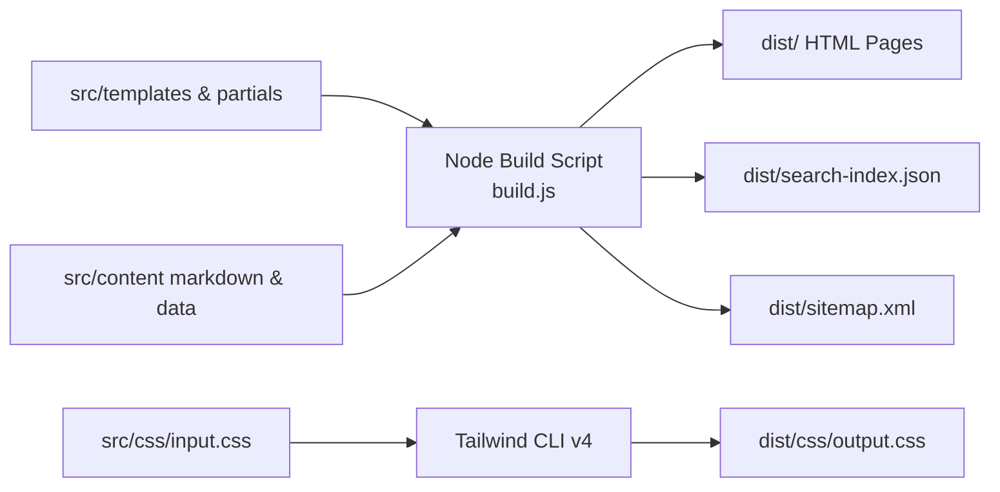

# Implementation Plan: Nagad SDK Documentation & Marketing Website

**Location**: `/website`  
**Purpose**: Build a professional, fast, accessible, Stripe/Vercel-grade documentation and marketing website for `nagad-server` and `nagad-client`.  
**Stack**: Plain HTML5 + Tailwind CSS (via Tailwind CLI v4, no CDN) + Vanilla JavaScript (ES Modules). Zero frontend framework dependencies.

---

## 1. Information Architecture & Sitemap

```
website/
├── dist/                          # Compiled production artifacts (ready for Pages deployment)
│   ├── index.html                 # Marketing Homepage
│   ├── docs/                      # Comprehensive Documentation Portal
│   │   ├── index.html             # Redirects to getting-started.html
│   │   ├── getting-started.html   # Quickstart, installation, environment setup
│   │   ├── core-concepts.html     # Cryptographic handshake, state machine, callback vs verify
│   │   ├── key-setup.html         # RSA key generation, portal upload, whitelisting
│   │   ├── server-guide.html      # nagad-server configuration, adapters, hooks, raw()
│   │   ├── client-guide.html      # nagad-client, React, React Native, Vue, Angular
│   │   ├── customization-theming.html # UI boundaries, theme tokens, Bangla/English
│   │   ├── error-reference.html   # Complete 16_0006_xxx error taxonomy
│   │   ├── testing.html           # Local mock simulator, throwaway keys, vitest
│   │   ├── security-checklist.html# Critical security rules & zero-trust verification
│   │   ├── production-checklist.html # Pre-launch IP/domain whitelisting checklist
│   │   ├── troubleshooting.html   # Common pitfalls (clock skew, signature verification, duplicate order ID)
│   │   ├── faq.html               # Frequently asked questions
│   │   └── migration.html         # Migrating from legacy packages (nagadApi, nagad-payment-gateway)
│   ├── playground.html            # Client-side interactive checkout simulator
│   ├── examples.html              # Runnable code recipes (Express, Next.js, Hono, React Native)
│   ├── api-reference.html         # Type-safe API signatures & TypeDoc reference
│   ├── changelog.html             # Release notes & semantic version history
│   ├── sitemap.xml                # Automated SEO sitemap
│   ├── robots.txt                 # Search bot rules
│   ├── css/output.css             # Tailwind CLI compiled & minified stylesheet
│   └── js/                        # Modular vanilla ES scripts
└── src/                           # Source templates, markdown content, and partials
```

---

## 2. Content Outline Mapped to Real Source Files

All documentation content strictly derives from verified repository artifacts and official specifications:

| Website Page | Primary Source Files | Key Topics Documented |
| :--- | :--- | :--- |
| **Homepage (`/`)** | `docs/AUDIT.md`, `README.md` | Value proposition, zero-dep crypto, package manager install, 10-line quickstart tabs, security highlights, roadmap strip ("Coming soon" labels). |
| **Getting Started** | `docs/AUDIT.md` §1-2 | Installing `nagad-server` & `nagad-client`, environment variables (`NAGAD_MERCHANT_ID`, `NAGAD_MERCHANT_PRIVATE_KEY`, `NAGAD_PG_PUBLIC_KEY`), zero-config init. |
| **Core Concepts** | `docs/AUDIT.md` §2, §3 | Two-step handshake (`initialize` $\to$ `complete`), state machine (`initialized` $\to$ `redirected` $\to$ `callback_received` $\to$ `verified`), **The Golden Rule**: never trust callback query parameters without server verification. |
| **Key Setup Guide** | `docs/AUDIT.md` §3, §8 | `openssl genrsa` 2048-bit keys, uploading public key in Nagad Merchant Portal, downloading Nagad PG certificate, format normalization (PKCS#1 vs PKCS#8), `.gitignore` safeguard. |
| **Server Guide** | `docs/AUDIT.md` §3, §5 | `createNagad()` API, layered control (zero-config, typed options, hooks, transport injection, `raw()`), clock skew (`Asia/Dhaka`), secret redaction, idempotency store. |
| **Client Guide** | `docs/AUDIT.md` §2, §6 | Headless state machine, React hook `useNagadCheckout`, React Native `<NagadCheckout />` WebView + back-button & deep linking, Vue 3 composable, Angular service. |
| **Customization & Theming** | `docs/AUDIT.md` §6 | Hosted page boundaries (Nagad handles wallet/PIN/OTP; custom UI surrounds it), theme tokens, dark mode, bilingual text tokens (English / Bangla). |
| **Error Reference** | `docs/AUDIT.md` §10 | Nagad error code taxonomy (`16_0006_004`, `16_0006_058`, `16_0006_076`, `16_0006_083`), root cause analysis, programmatic resolution. |
| **Testing** | `docs/AUDIT.md` §7, §9 | Local mock simulator server, throwaway RSA key pair generation, sandbox test cards & phone numbers, callback tampering tests. |
| **Security Checklist** | `docs/AUDIT.md` §7 | Strict amount & order ID checks, preventing race conditions, replay protection, Gitleaks scanning in CI, secret isolation. |
| **Production Go-Live** | `docs/AUDIT.md` §5, §8 | Merchant account registration, Public IP egress whitelisting (`X-KM-IP-V4`), HTTPS callback URL registration, production base URL switch. |
| **Troubleshooting** | `docs/AUDIT.md` §7, §10 | Fixing clock skew errors, resolving RSA signature verification failures, diagnosing HTTP 403 / IP rejection. |
| **Playground (`/playground.html`)** | `docs/AUDIT.md` §2 | Zero-network interactive simulator: simulates complete flow from checkout init, modal hosted UI, OTP/PIN submission, callback handling, and tampering detection. |

---

## 3. Design System & Tokens (Fintech Developer Aesthetic)

The visual identity delivers a sleek, trustworthy, high-performance developer aesthetic (Stripe / Vercel / Linear inspired). It deliberately uses its own distinct color identity to avoid confusion with official Nagad commercial branding (red-orange) or sibling bKash branding (pink/magenta).

### 3.1 Color Palette

```css
:root {
  /* Brand Accent: Radiant Sunset Amber & Copper (Visibly distinct from Nagad red & bKash pink) */
  --color-brand-primary: #f59e0b;       /* Amber-500 */
  --color-brand-secondary: #d97706;     /* Amber-600 */
  --color-brand-dark: #b45309;          /* Amber-700 */
  --color-brand-glow: rgba(245, 158, 11, 0.18);
  --color-brand-gradient: linear-gradient(135deg, #f59e0b 0%, #ea580c 100%);

  /* Neutrals: Light Mode */
  --bg-canvas: #fafafa;
  --bg-surface: #ffffff;
  --bg-surface-elevated: #f1f5f9;
  --border-subtle: #e2e8f0;
  --border-strong: #cbd5e1;
  --text-primary: #0f172a;
  --text-secondary: #475569;
  --text-muted: #64748b;

  /* Neutrals: Dark Mode (Default) */
  --dark-bg-canvas: #090d16;
  --dark-bg-surface: #0f172a;
  --dark-bg-surface-elevated: #1e293b;
  --dark-border-subtle: rgba(255, 255, 255, 0.08);
  --dark-border-strong: rgba(255, 255, 255, 0.16);
  --dark-text-primary: #f8fafc;
  --dark-text-secondary: #94a3b8;
  --dark-text-muted: #64748b;

  /* Status Colors */
  --status-success: #10b981;
  --status-warning: #f59e0b;
  --status-error: #f43f5e;
  --status-info: #0ea5e9;
}
```

### 3.2 Typography & Dual-Language Font Stack
- **English Body & Headings**: Inter / -apple-system, BlinkMacSystemFont, "Segoe UI", Roboto, sans-serif.
- **Bangla Font Stack**: `'Hind Siliguri'`, `'Noto Sans Bengali'`, `'SolaimanLipi'`, sans-serif.
- **Code & Monospace**: `'JetBrains Mono'`, `'Fira Code'`, ui-monospace, SFMono-Regular, monospace.
- **Fluid Type Scale**: `text-xs` (12px), `text-sm` (14px), `text-base` (16px), `text-lg` (18px), `text-xl` (20px), `text-2xl` (24px), `text-4xl` (36px), `text-5xl` (48px).

---

## 4. Component Architecture (Vanilla HTML5 + JS Modules)

To ensure maximum performance (<40 KB gzip, zero framework overhead), components are built as semantic HTML templates with vanilla ES module controllers:

1. **`Navbar`**: Responsive desktop/mobile header, project wordmark, navigation links, GitHub badge, theme toggle button, Bangla/English switcher, search modal trigger (`Cmd+K`).
2. **`QuickstartTabs`**: Multi-framework tabs (Node/Express, Next.js, React, React Native, Vue, Angular) switching code snippets synchronously.
3. **`PackageManagerTabs`**: Synchronized package-manager selector (`pnpm`, `npm`, `yarn`, `bun`) persisting preference across all pages.
4. **`CodeSnippet`**: Syntax-highlighted code container with copy button, line numbers, and language badge.
5. **`DocsSidebar`**: Collapsible grouped navigation with active page indicator, scroll preservation, and mobile drawer.
6. **`TableOfContents (TOC)`**: Scrollspy-driven dynamic heading tracker (`IntersectionObserver`).
7. **`SearchModal`**: Full-screen / dialog search with fuzzy matching across `search-index.json`, keyboard shortcut (`/` and `Cmd+K`), highlighting matches, and arrow key navigation.
8. **`InteractiveSimulator`**: Zero-network playground replicating the checkout flow with real-time reactive code output and simulated callback verification.
9. **`RoadmapStrip`**: Visual status badges differentiating active features from upcoming roadmap items ("Coming soon").
10. **`DisclaimerFooter`**: Mandatory legal disclaimers ("Unofficial, not affiliated with or endorsed by Nagad", MIT License).

---

## 5. Build Pipeline & Tooling (`website/scripts/`)

Minimalist, blazing-fast static build system:



- **CSS Compilation**: Run `tailwindcss -i src/css/input.css -o dist/css/output.css --minify` using the local `@tailwindcss/cli`.
- **HTML Compilation**: Lightweight Node.js script (`website/scripts/build.js`) that reads layout templates (`layout.html`, `docs-layout.html`), injects partials (`nav.html`, `footer.html`, `sidebar.html`), parses markdown documents, formats syntax blocks, and outputs clean static `.html` files into `dist/`.
- **Search Indexer**: Scans all docs pages, extracts headings and text content, and writes a compact `dist/search-index.json` (~15 KB).
- **Asset Fingerprinting**: Cache-busting query strings for JS/CSS in production builds.

---

## 6. Interactive Playground Architecture (`/playground.html`)

A client-side simulator demonstrating the complete Nagad payment flow without requiring live credentials:

1. **Configuration Stage**:
   - Inputs: Merchant Name, Amount (BDT), Order ID (auto-generated), Language (English / Bangla), Simulated Scenario (Clean Success, Payment Cancelled, User Tampered Amount, Network Failure).
2. **Handshake Stage**:
   - Visualizes Step 1 (Initialize) and Step 2 (Complete) generating dummy encrypted payloads.
3. **Hosted Modal Simulation**:
   - Opens an authentic modal replicating the Nagad payment UI (without capturing real credentials).
   - Simulates OTP generation, OTP verification, and PIN submission.
4. **Callback & Verification Simulation**:
   - Simulates Nagad redirecting back to the callback URL with query parameters.
   - Runs simulated `nagad.checkout.verify()` showing how tampering is immediately caught.
5. **Live Code Generation**:
   - Dynamically updates a live copy-pasteable TypeScript code block matching the user's selected configuration.

---

## 7. Quality, Performance & Accessibility Targets

- **Lighthouse Scores**: $\ge$ 95 in Performance, Accessibility, Best Practices, and SEO.
- **Performance**: LCP < 2.0s on simulated mobile, FID/INP < 100ms, zero Cumulative Layout Shift (CLS). Total initial JS < 40 KB gzip.
- **Accessibility**: WCAG 2.2 Level AA compliance, semantic landmarks (`<main>`, `<nav>`, `<aside>`), skip-to-content link, keyboard accessibility for all modals and tabs, color contrast ratio $\ge$ 4.5:1.
- **SEO & Social**: Descriptive metadata, Open Graph & Twitter Cards, canonical tags, JSON-LD `SoftwareApplication` schema, valid `sitemap.xml` and `robots.txt`.
- **CI / GitHub Actions**: Automated build job compiling Tailwind CSS, validating HTML, running link-checkers, and deploying to GitHub Pages with base-path awareness.

---

## 8. Phased Execution Roadmap

- **Phase A (Current)**: Research, detailed design system, and project plan (`website/PLAN.md` + `website/OPEN_QUESTIONS.md`). **[STOP FOR USER APPROVAL]**
- **Phase B**: Core build script, Tailwind CSS v4 setup, design tokens, shared layout partials, and the interactive Marketing Homepage (`/index.html`).
- **Phase C**: Complete Documentation Portal (all 13 docs pages), sidebar navigation, TOC scrollspy, and client-side fuzzy search (`Cmd+K`).
- **Phase D**: Interactive Checkout Simulator (`/playground.html`), Code Recipes (`/examples.html`), and Version History (`/changelog.html`).
- **Phase E**: SEO meta tags, social sharing cards, accessibility audit, GitHub Actions workflow for automated Pages deployment.
